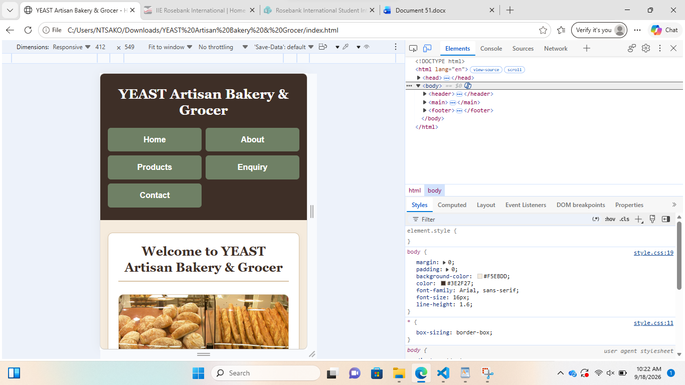
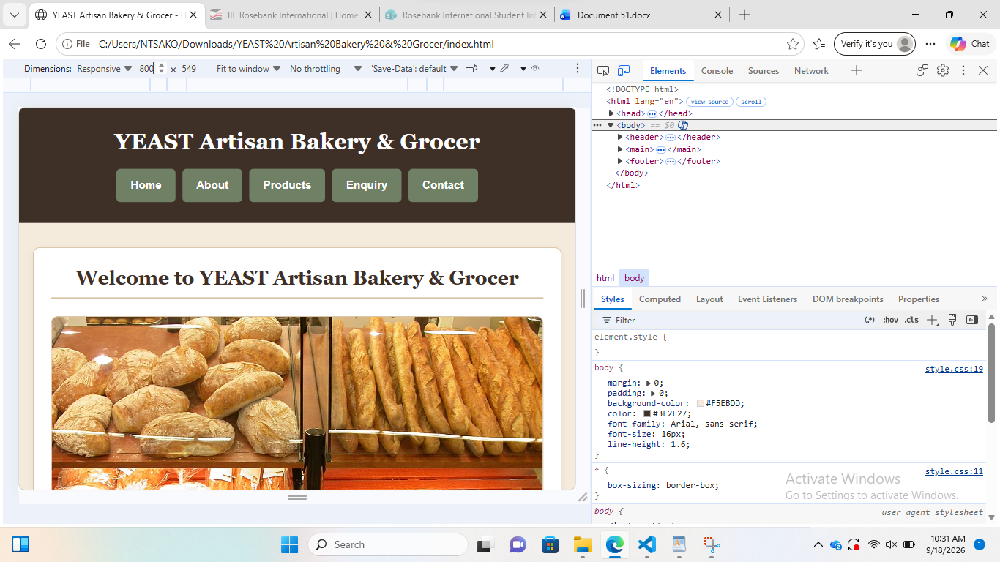
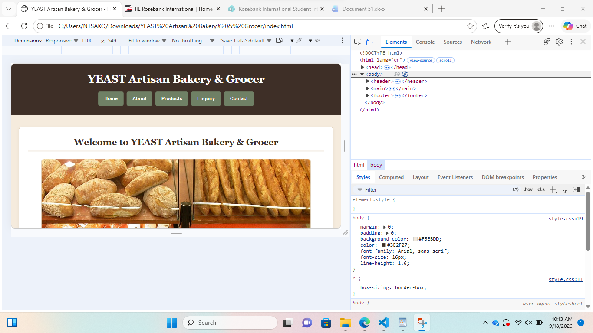

# YEAST Artisan Bakery & Grocer Website

## Student Information

**Student Name:** Ntsako Thandi Gomba  
**Student Number:** ST10467985  
**Module:** Web Development  
**Module Code:** WEDE5020  
**Programme:** Bachelor of IT in Business Systems

## Website Description

This website was created for **YEAST Artisan Bakery & Grocer**.

The website provides information about the organisation, its bakery products, locations, contact details and product enquiries.

## Website Goals and Objectives

The main goal of the YEAST Artisan Bakery & Grocer website is to provide visitors with clear, accessible and organised information about the organisation and its products.

The objectives of the website are to:

- Provide information about YEAST Artisan Bakery & Grocer.
- Display bakery products with descriptions and images.
- Provide information about the organisation's locations.
- Allow customers to make product enquiries.
- Provide contact information for customers.
- Provide clear and consistent navigation across all pages.
- Create a responsive and mobile-friendly website.
- Present the organisation in a professional and visually appealing manner.

## Website Pages

- **Home** (`index.html`)
- **About** (`about.html`)
- **Products** (`products.html`)
- **Enquiry** (`enquiry.html`)
- **Contact** (`contact.html`)

## Sitemap

```text
YEAST Artisan Bakery & Grocer Website
│
├── Home
│   └── index.html
│
├── About
│   └── about.html
│
├── Products
│   └── products.html
│
├── Enquiry
│   └── enquiry.html
│
└── Contact
    └── contact.html
```

## Technologies Used

- HTML5
- CSS3
- JavaScript
- Leaflet
- OpenStreetMap
- Visual Studio Code
- Git
- GitHub
- GitHub Pages
- Live Server extension for Visual Studio Code

## Website Features

- Clear navigation
- Responsive and mobile-friendly layout
- Product cards
- Product images
- Product descriptions
- Product search functionality
- Product image lightbox
- Interactive map showing both locations
- Enquiry form with validation
- Contact form with validation
- Contact email preparation through Gmail
- Contact information
- Consistent design and footer
- Semantic HTML5 structure
- External CSS stylesheet
- JavaScript functionality

## Part 1 Project Timeline

The following activities were completed during Part 1:

- Organisation research and selection
- Website project proposals
- Content research and sourcing
- Sitemap planning
- Website structure planning
- Creation of the five HTML pages
- Creation of the project folder structure
- Creation of the README documentation
- Initial GitHub repository setup

## Part 1 Testing and Debugging

The website was checked during development to ensure that the required pages, navigation and website structure were working correctly.

The following areas were considered during Part 1 testing:

- Navigation links between all five pages
- Page layout and content
- Images and image paths
- Enquiry form
- CSS styling
- HTML structure
- Website links
- Code readability
- Responsive layout considerations

Testing and debugging were performed during development, and improvements were made where necessary.

Cross-browser testing was performed in Microsoft Edge and Google Chrome. The Home, About, Products, Enquiry and Contact pages were checked in both browsers. Navigation links, page layout, images and content were confirmed to display and function correctly.

## Image Sources

Images used on the website are sourced from appropriate free-to-use, public-domain or Creative Commons sources where applicable.

Image sources and licensing information are recorded in the project documentation and reference list.

## Image References — Harvard Style

Abdellah zou (n.d.) *Pastry,.jpg* [Photograph]. Available at: https://commons.wikimedia.org/wiki/File:Pastry,.jpg (Accessed: 20 August 2026).

Anasuyas (n.d.) *Sourdough bread.jpg* [Photograph]. Available at: https://commons.wikimedia.org/wiki/File:Sourdough_bread.jpg (Accessed: 20 August 2026).

Domingo, E.B. (n.d.) *Breads from a local bakery.jpg* [Photograph]. Available at: https://commons.wikimedia.org/wiki/File:Breads_from_a_local_bakery.jpg (Accessed: 20 August 2026).

Downtowngal (2010) *Ralphs bakery case.jpg* [Photograph]. Available at: https://commons.wikimedia.org/wiki/File:Ralphs_bakery_case.jpg (Accessed: 20 August 2026).

JIP (2022) *Mini cupcakes.jpg* [Photograph]. Available at: https://commons.wikimedia.org/wiki/File:Mini_cupcakes.jpg (Accessed: 20 August 2026).

Jungle Jim's International Market (2004) *Artisan breads.jpg* [Photograph]. Available at: https://commons.wikimedia.org/wiki/File:Artisan_breads.jpg (Accessed: 20 August 2026).

Lam, W. (2015) *Savory Peasant Pies* [Photograph]. Available at: https://commons.wikimedia.org/wiki/File:Savory_Peasant_Pies_(23374802751).jpg (Accessed: 20 August 2026).

Orizan (n.d.) *Tray of Chelsea buns in Fitzbillies Cambridge.jpg* [Photograph]. Available at: https://commons.wikimedia.org/wiki/File:Tray_of_Chelsea_buns_in_Fitzbillies_Cambridge.jpg (Accessed: 20 August 2026).

Shwetha manju (2015) *Cake img.jpg* [Photograph]. Available at: https://commons.wikimedia.org/wiki/File:Cake_img.jpg (Accessed: 20 August 2026).

Sone, D. (n.d.) *Assortment of breads and pastries.jpg* [Photograph]. Available at: https://commons.wikimedia.org/wiki/File:Assortment_of_breads_and_pastries.jpg (Accessed: 20 August 2026).

## Part 1 Changelog

### Initial Development

- Created the YEAST Artisan Bakery & Grocer website.
- Created five HTML pages: Home, About, Products, Enquiry and Contact.
- Added an external CSS stylesheet.
- Added product images and content.
- Implemented navigation between the five pages.
- Added an enquiry form.
- Added contact and location information.
- Created the project folder structure.
- Added project documentation and image references.
- Created the GitHub repository.

### Part 1 Feedback Improvements

- Added a formal sitemap to the README.
- Added website goals and objectives.
- Added Part 1 project timeline information.
- Added Part 1 testing and debugging documentation.
- Added a formal changelog.
- Improved README project documentation.

## Project Structure

```text
YEAST-Website/
│
├── index.html
├── about.html
├── products.html
├── enquiry.html
├── contact.html
│
├── css/
│   └── style.css
│
├── js/
│   └── script.js
│
├── images/
│
├── robots.txt
├── sitemap.xml
│
└── README.md
```

## Part 2 Changelog

### Part 2 — Working through Feedback from Part 1

The following feedback was received for Part 1:

- Target Organisation Selection: 5/5. YEAST Artisan Bakery & Grocer was considered an appropriate organisation.
- Website Proposal 1: 14/15. The proposal was comprehensive, with only minor detail that could be added.
- Website Proposal 2: 14/15. The proposal was complete and very well developed.
- Content Research and Sourcing: 9/10. The research was strong, but some source and licensing evidence could have been more explicit.
- Sitemap: 7/8. The sitemap was good, but it was mainly presented as a document representation rather than a highly detailed visual diagram.
- File and Folder Structure: 7/7. The project was well organised.
- HTML Pages and Structure: 14/15. All five pages were present and used appropriate HTML5 structure, semantic elements, headings, images, links and meaningful content.
- Navigation: 8/8. Navigation was consistent across all five pages and the relative links worked correctly.
- Testing, Debugging and Code Comments: 5/7. The website included explanatory comments and responsive CSS, but stronger cross-browser testing and debugging evidence was required.
- GitHub Repository and Version Control: 2/5. Only one initial commit was available, and regular commits with descriptive messages were required.
- README: 4/5. The README included important project information, but a formal changelog, sitemap and some Part 1 documentation needed improvement.
- Submission Requirements: 4/5. Most requirements were met, with Git and version control being the main weakness.

Based on this feedback, the following corrections and improvements were made:

- Added clearer cross-browser testing and debugging evidence.
- Added testing evidence for the five website pages, including navigation, images, content and page layout.
- Created multiple descriptive Git commits to document development progress.
- Improved the README by adding a formal changelog and additional project documentation.
- Added a clearer sitemap and project structure to the README.
- Added clearer information about image sources and licensing.

### Part 2 GitHub Version Control

The project was regularly updated using Git and GitHub during Part 2. Multiple descriptive commits were created to document development progress and changes made to the project.

The following commits were made:

1. `Update README with Part 1 feedback improvements`
   - Updated the README to document improvements made in response to the Part 1 feedback.
   - Added website goals and objectives, sitemap, project timeline, testing and debugging information, and the Part 1 changelog.

2. `Add cross-browser testing evidence`
   - Added documentation showing that the website was tested in Google Chrome and Microsoft Edge.
   - Documented testing of the five website pages and confirmed that navigation, images, content and page layout were displaying correctly.

3. `Improve desktop CSS styling`
   - Improved the external CSS stylesheet for the desktop version of the website.
   - Improved typography, spacing, layout, colours, navigation, buttons, forms, product cards and visual styling.
   - Added CSS pseudo-classes including `:hover`, `:focus` and `:active`.

4. `Update README with Part 2 documentation`
   - Updated the README with Part 2 development information.
   - Added documentation for CSS styling, responsive design, testing and Part 2 changes.

5. `Add Git and GitHub to technologies`
   - Updated the Technologies Used section of the README to include Git and GitHub.
   - Documented the version-control tools used during website development.

6. `Add responsive image styling`
   - Improved image styling in the external CSS stylesheet.
   - Ensured images scale correctly within different screen sizes.

7. `Complete Part 2 CSS and responsive design`
   - Completed the CSS styling and responsive design requirements for Part 2.
   - Added and tested responsive layouts for desktop, tablet and mobile screen sizes.
   - Added responsive testing screenshots to the README.

All Part 2 changes were committed using descriptive commit messages and pushed to the remote GitHub repository.

The GitHub repository provides evidence of ongoing development and version control throughout the project.

## Part 2 Responsive Testing

### Mobile Testing — 412 × 549 px

The website was tested at a mobile viewport size of 412 × 549 pixels. The navigation changed to a two-column layout, and the Featured Products displayed one underneath another. The content, images and page layout fitted within the viewport without horizontal overflow.



### Tablet Testing — 800 × 549 px

The website was tested at a tablet viewport size of 800 × 549 pixels. The Our Products section displayed product cards side-by-side. The content, images and page layout fitted within the viewport without horizontal overflow.



### Desktop Testing — 1100 × 549 px

The website was tested at a desktop viewport size of 1100 × 549 pixels. The website displayed correctly, with the content, images and layout fitting within the viewport.



## Part 3 Changelog

### Part 3 — Working through Feedback from Part 2

The lecturer's feedback for Formative 2 Part 2 was received on 02 October 2026. The website received a mark of **100/100 (100%)**. All marking criteria were rated as **Greatly Exceeds**.

The lecturer confirmed the following:

- **Knowledge – Updates based on feedback & changelog: 10/10.** The Part 2 changelog explicitly recorded the Part 1 feedback and corrective actions, including testing evidence, Git commits, README improvements, image licensing and responsive work.
- **External stylesheet created and implemented in each web page: 10/10.** The external CSS stylesheet, `css/style.css`, was correctly created and linked to the website pages.
- **CSS – Default Style Code: 5/5.** Comprehensive styling was provided for the body, images, links, lists, headings, paragraphs, box sizing, colours, spacing and line height.
- **CSS – Typography Styles: 5/5.** Consistent font families, sizes, weights, line heights, colours and responsive `clamp()` sizing were used.
- **CSS – Layout Structure: 5/5.** Flexbox, grid, maximum-width containers, spacing, padding and structured content sections were implemented effectively.
- **CSS – Decoration and Colour: 5/5.** The website included colour combinations, borders, shadows, rounded corners, buttons and section styling.
- **CSS – Pseudo-Classes Used: 10/10.** The `:hover`, `:focus` and `:active` pseudo-classes were implemented for navigation, links, buttons and form controls.
- **Responsive Design – Media Queries/Breakpoints: 10/10.** Responsive breakpoints were implemented at 800px and 520px.
- **Responsive Design – Layout: 5/5.** Product grids changed from two columns to one column on mobile, and spacing was adjusted.
- **Responsive Design – Typography: 5/5.** Responsive heading typography was implemented using `clamp()`.
- **Responsive Design – Navigation Menu: 5/5.** The horizontal flex navigation changed to a two-column grid layout on mobile.
- **Responsive Design – Images: 5/5.** Images used responsive sizing with `max-width: 100%` and `height: auto`, together with page-specific styling.
- **GitHub – Multiple Descriptive Commits: 5/5.** Multiple descriptive Part 2 commits documented desktop CSS, responsive images, responsive design and README improvements.
- **GitHub – README Document: 5/5.** The README included student and project information, objectives, pages, sitemap, technologies, features, testing, references and Part 1 and Part 2 documentation.
- **GitHub – Changelog: 5/5.** A dedicated Part 2 changelog documented feedback received, improvements and the development process.
- **References: 5/5.** Harvard-style image references included multiple named sources, URLs and access dates.

No corrective changes were identified in the lecturer's Part 2 feedback. Therefore, the existing website design, CSS styling and responsive features will be maintained while the functionality and SEO improvements required for Part 3 are developed.

### Part 3 — Functionality Improvements

The following functionality improvements have been implemented as part of Part 3:

- Created a JavaScript file, `js/script.js`, and linked it to all five HTML pages.
- Added product search functionality on the Products page, allowing visitors to search and filter product categories.
- Added an image lightbox that allows visitors to click product images to view them in an enlarged format.
- Added an interactive Leaflet map to the Contact page showing the YEAST Bedfordview and Dunvegan locations.
- Improved the Enquiry form by adding required fields, input validation and a confirmation message after successful form submission.
- Improved the Contact form by adding required fields, input validation and a message type selection.
- Added JavaScript functionality to prepare contact form details in a Gmail compose window, allowing visitors to review and send their messages.
- Tested the product search, image lightbox, interactive map, Enquiry form and Contact form during development.

### Part 3 — JavaScript and Form Functionality

JavaScript was used to improve website interaction and functionality. The product search allows visitors to find product categories, while the image lightbox provides an enlarged view of product images.

The Enquiry form checks the submitted information and displays a confirmation message. The Contact form validates the visitor's details and prepares an email in Gmail with the recipient, subject and message information filled in. The visitor can review the email and send it through Gmail.

### Part 3 — Technologies Added

- JavaScript
- Leaflet
- OpenStreetMap
- Live Server extension for Visual Studio Code

### Part 3 — Testing

The new functionality was tested using the Live Server extension in Visual Studio Code. The product search, image lightbox, map display, Enquiry form validation and Contact form email preparation were checked to confirm that they worked as expected.

## Part 3 — Search Engine Optimisation (SEO)

### On-Page SEO

SEO improvements were made to all five HTML pages to help search engines understand the content of the YEAST Artisan Bakery & Grocer website.

The following improvements were implemented:

- Added a unique page title to each HTML page.
- Added a meta description to each page to describe its content.
- Added relevant keywords to the meta keywords tags.
- Added author meta tags.
- Improved image alternative text (alt text) to describe the images.
- Used descriptive headings and relevant page content.
- Maintained internal links between the five website pages.
- Maintained the responsive and mobile-friendly website layout.

### Technical SEO

Two additional files were created in the main project folder:

- `robots.txt` — allows search engine crawlers to access the website and provides the location of the sitemap.
- `sitemap.xml` — lists all five website pages: Home, About, Products, Enquiry and Contact.

The sitemap is available at:

https://st10467985.github.io/YEAST-Artisan-Bakery-Grocer/sitemap.xml

The robots file is available at:

https://st10467985.github.io/YEAST-Artisan-Bakery-Grocer/robots.txt

### Local SEO and Social Media

The website includes information about the YEAST Bedfordview and Dunvegan locations. The Contact page provides location details, contact information and an interactive map to help visitors find the two locations.

The existing Instagram link is also available on the website to help visitors access the organisation's social media page.

### Website Deployment

The website was published using GitHub Pages. The repository is configured to deploy from the `master` branch and the root folder.

**Live website:**

https://st10467985.github.io/YEAST-Artisan-Bakery-Grocer/

### SEO Testing

The following checks were completed:

- Checked that all five HTML pages contain page titles and meta descriptions.
- Checked that `robots.txt` opens correctly on the published website.
- Checked that `sitemap.xml` opens correctly on the published website.
- Confirmed that the sitemap lists all five website pages.
- Confirmed that the GitHub Pages deployment completed successfully.

### Part 3 GitHub Version Control

The SEO updates were committed and pushed to the GitHub repository using the following commit message:

`Complete Part 3 SEO updates and add sitemap`

The updated HTML pages, `robots.txt`, `sitemap.xml` and README documentation form part of the Part 3 website development.
### 3.2 Off-page SEO

**1. Backlinks**

YEAST Artisan Bakery & Grocer can improve its online visibility by obtaining backlinks from local business directories, food blogs and websites that promote businesses in Bedfordview and Dunvegan. These links can direct visitors to the YEAST website and help improve its search engine visibility.

**2. Social Media Promotion**

Social media platforms can be used to promote YEAST and attract more visitors to the website. Facebook can be used to share business updates and promotions, Instagram to display photographs of bakery products, and WhatsApp Business to communicate with customers and share product information.

**3. Local SEO**

Local SEO helps customers find YEAST when searching for bakeries in their area. The business can use Google Business Profile to display its Bedfordview and Dunvegan locations, contact details, opening hours and customer reviews. Local keywords such as "artisan bakery in Bedfordview" and "bakery in Dunvegan, Edenvale" can also improve local search visibility.